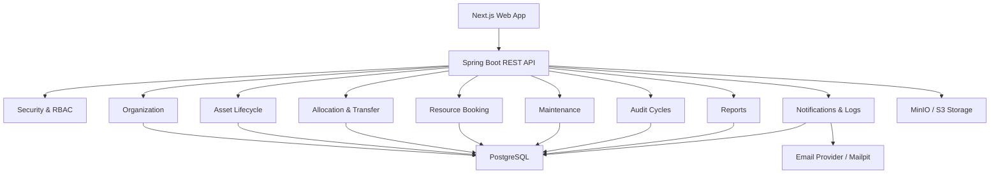

# AssetFlow — Engineering & Delivery Plan

> Enterprise Asset & Resource Management System built with Java, Spring Boot, PostgreSQL, and Next.js.

## 1. Document Purpose

This document is the master implementation plan for AssetFlow. It defines product scope, architecture, domain rules, security boundaries, development phases, testing strategy, GitHub workflow, and the path toward 1,000+ meaningful commits and 200+ reviewable pull requests.

The project is developed as a production-style ERP system, not as a collection of disconnected CRUD screens.

---

## 2. Product Vision

AssetFlow enables organizations to centrally manage physical assets and shared resources across their complete operational lifecycle.

The system will answer the following questions reliably:

- What assets does the organization own?
- Who currently holds each asset?
- Where is each asset located?
- What condition and lifecycle state is each asset in?
- Which shared resources are available at a requested time?
- Which returns, bookings, maintenance jobs, and audits require attention?
- Who performed every important action and when?

AssetFlow intentionally excludes purchasing, invoicing, payroll, and accounting.

---

## 3. Recommended Architecture



---

## 4. Package Structure & Module Isolation

AssetFlow is structured as a **Modular Monolith** using **Package-by-Feature**:

```text
assetflow/
├── backend/
│   ├── src/main/java/com/assetflow/
│   │   ├── shared/
│   │   ├── identity/
│   │   ├── organization/
│   │   ├── asset/
│   │   ├── allocation/
│   │   ├── booking/
│   │   ├── maintenance/
│   │   ├── audit/
│   │   ├── notification/
│   │   ├── reporting/
│   │   └── activitylog/
│   ├── src/test/
│   └── pom.xml
├── frontend/
├── infrastructure/
├── docs/
├── .github/
└── docker-compose.yml
```

Each module adheres to clean internal layering:

```text
asset/
├── api/             # Controllers, Request/Response DTOs
├── application/     # Use cases, Application Services, Mappers
├── domain/          # Aggregates, Value Objects, Domain Services, Repositories (Interfaces)
└── infrastructure/  # JPA Repositories, Persistence Adapters, Storage Integrations
```

---

## 5. Domain Rules & Core Invariants

### 1. Multi-Tenant Isolation
- Every tenant-owned table contains `organization_id`.
- Tenant context is strictly resolved from the authenticated JWT session.
- Accessing cross-tenant data yields `404 Not Found` or `403 Forbidden`.

### 2. Role Elevation Security
- Public signup always creates an `EMPLOYEE`.
- Role elevation requires an explicit administrative workflow and creates an activity log entry.
- Initial admin user is created via an explicit bootstrap CLI command or secure invite token.

### 3. Asset Lifecycle State Machine
Supported statuses: `AVAILABLE`, `ALLOCATED`, `RESERVED`, `UNDER_MAINTENANCE`, `LOST`, `RETIRED`, `DISPOSED`.
- Lifecycle updates pass exclusively through `AssetLifecycleService`.
- Disposed assets cannot return to service.

### 4. Double-Allocation Prevention
- Application-level pessimistic/optimistic locking during allocation.
- Database level partial unique index:
  ```sql
  CREATE UNIQUE INDEX uq_active_asset_allocation 
  ON asset_allocations(asset_id) 
  WHERE returned_at IS NULL;
  ```

### 5. Resource Booking Overlap Prevention
- Time slots use half-open intervals `[start_time, end_time)`.
- Overlap query rule: `existing.start < requested.end AND existing.end > requested.start`.
- Enforced via PostgreSQL exclusion constraints and transactional validation.

### 6. Audit Immutability
- Closed audit cycles generate discrepancies, apply state transitions, and lock immutable audit records in a single transactional operation.

---

## 6. Implementation Roadmap Summary

- **Phase 0**: Project Foundation, Architecture Docs, CI/CD pipelines, Docker Compose setup.
- **Phase 1**: Identity, JWT Auth with Refresh Tokens, Tenant Isolation.
- **Phase 2**: Organization, Departments, Employee Directory, Controlled Promotion.
- **Phase 3**: Asset Category & Dynamic Fields, Tag Generator, Asset Directory & History.
- **Phase 4**: Asset Allocation, Transfers, Overdue Detection & Notifications.
- **Phase 5**: Shared Resource Booking, Overlap Protection, Calendar View.
- **Phase 6**: Maintenance Requests, Approval Workflow, Technician Assignment & Resolution.
- **Phase 7**: Audit Cycles, Scope Snapshots, Auditor Verification & Discrepancies.
- **Phase 8**: Dashboards, Analytics, PDF/CSV Exports & Audit Logs.

---

## 7. Delivery Strategy: PR & Commit Plan

Total PR Target: **~242 Pull Requests** (~1,000+ meaningful commits).

Workstream breakdown:
- Foundation & Architecture: 16 PRs
- CI/CD & Environment: 16 PRs
- Identity & Security: 24 PRs
- Organization & Employees: 22 PRs
- Asset Management: 32 PRs
- Allocation & Transfers: 28 PRs
- Resource Booking: 22 PRs
- Maintenance: 22 PRs
- Audits: 22 PRs
- Reports & Dashboard: 18 PRs
- Notifications & Hardening: 20 PRs
